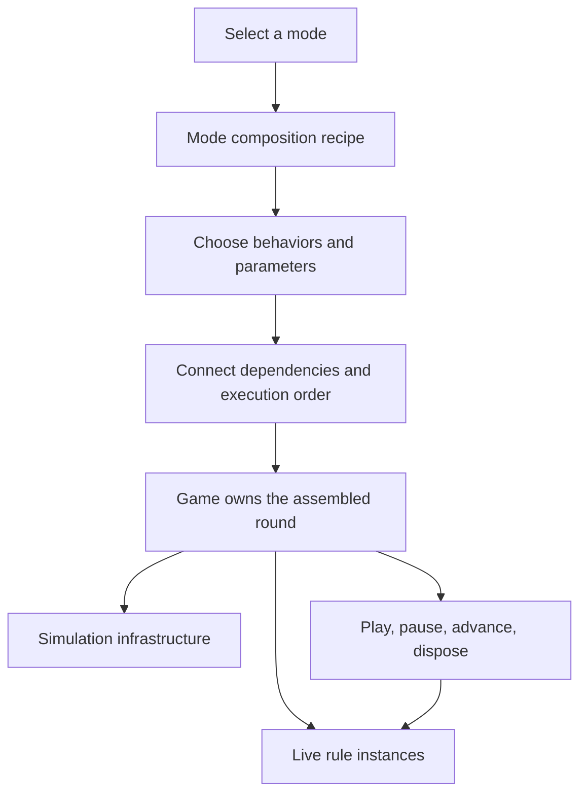
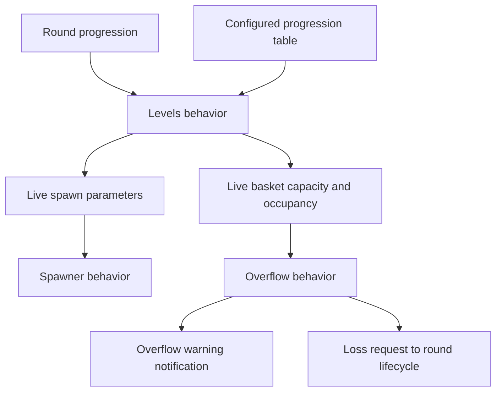
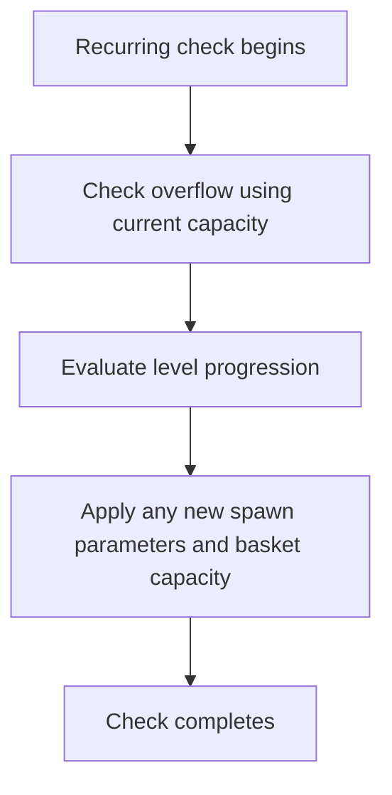

# Round composition

Status: design exploration. This document records a proposed direction, not an
implementation specification. Names and interfaces remain open for discussion.

This sits alongside [design.md](design.md). It revisits that document's Stage 5
split between game subclasses and data-only modes. It does not yet replace the
existing plan or change the status of its implementation tasks.

## Motivation

The current split leaves two awkward boundaries:

- `StandardGame` chooses the exact rule implementations, while `StandardMode`
  supplies their data. Changing the composition still requires another game
  implementation or changes to the existing subclass.
- Rules receive the entire game through `@game`. Their real dependencies are
  obscured by access to the round's state, infrastructure, and other rules.

Configuration has a similar problem. `Game.build_config` merges application
settings with mode overrides and knows about nested physics settings such as
`center_join`. The round host is interpreting configuration that belongs to its
individual consumers.

Separating behavior from data is useful, but it does not answer all three design
questions:

1. **Composition:** Which behaviors participate in a round?
2. **Configuration:** What parameters do those behaviors use?
3. **Access:** What state and operations may each behavior use?

## Proposed model

**A mode assembles a round. A game owns and runs it. Rules implement behavior.**

| Concept | Responsibility | Boundary |
|---|---|---|
| Mode | A round composition recipe: chooses implementations, supplies parameters, and connects dependencies and execution order. | Does not receive ongoing play, pause, or disposal callbacks. |
| Game / round | Owns the assembled instances and simulation infrastructure; advances the lifecycle and disposes the round. | Does not hardcode the standard gameplay composition. |
| Rule | Implements a behavior and owns its local runtime state. | Receives the dependencies it needs, not unrestricted access to the game. |
| Configuration | Describes initial parameters and progression data. | Is not mutated as the round progresses. |
| Settings | Holds application preferences such as audio, theme, and graphics. | Is not the catch-all source of gameplay tuning. |

"Game" is the current code name for the running round. Whether to rename it is
not decided here.

The mode may bring factories or construction code. That is intentionally more
powerful than a data-only preset. The restriction is about lifetime and ownership:
construction belongs to the recipe; ongoing behavior belongs to the objects it
constructs.

This is not a return to `mode.playing(game)`, `mode.stop(game)`, or a reusable mode
object carrying timers between rounds. The exact construction API is still open.

## ECS influence, without committing to ECS

ECS separates composition, data access, and execution scheduling. Those are useful
ideas here even if Naubino never adopts an ECS library or storage model.

| Typical ECS concept | Approximate Naubino analogue |
|---|---|
| Entity | A naub's identity |
| Component | Data such as position, color, or join membership |
| System | A behavior such as spawning, scoring, or overflow checking |
| Resource | Round-wide state such as score, basket capacity, or elapsed time |
| Schedule | Lifecycle phases and execution order |
| Plugin or application assembly | A composition recipe that installs behaviors |

Rules are closest to systems, not entities or components. Depending on the ECS,
systems can also have local state.

ECS does not make gameplay dependencies disappear. It can make reads, writes,
and ordering constraints explicit and sometimes enforce them. A system with
unrestricted access to a world can be just as coupled as a rule with unrestricted
access to `@game`.

The proposal does not require component storage, a query engine, an ECS package,
or converting every field into a component.

## Composition belongs at construction

A standard composition currently needs basket geometry, spawning, scoring,
overflow checking, and level progression. A playground needs different behavior,
such as initial population and gesture-driven spawning.

The composition recipe should select and connect those behaviors. The game host
should not need to know which combination means "standard" or "playground".

A new mode could reuse a composition with different tuning, choose an alternative
implementation of a behavior, or assemble a different composition. How much of
that freedom we need remains an open question.

If `StandardGame` exists only to construct standard rules, this model removes its
reason to exist. A game subclass would need a separate justification: a genuine
difference in the round host rather than a different list of behaviors.

We should not replace explicit assembly with a generic rule registry or dependency
injection framework by default. Ordinary construction and direct dependency wiring
may be sufficient.

## Dependencies should describe the behavior

The target is not "every rule is independent". Some behaviors inherently depend on
others or on shared domain state.

For example:

- Overflow reads basket occupancy, publishes a warning, and requests a loss.
- Scoring consumes destruction and cycle results and updates score.
- Levels reads progression and changes spawn parameters and basket capacity.

These are conceptual dependencies, not proposed class or signal definitions.
Whether basket capacity belongs to a rule, a shared resource, or a separate domain
object is not settled.

Passing a spawner control interface and basket access to `Levels` can accurately
express its dependencies. Passing the whole game grants much more access than it
needs.

Likewise, replacing `@game.basket` with `resources.get('basket')` is not necessarily
an improvement. A generic service locator can hide the same coupling behind a
lookup. Prefer concrete dependencies until evidence calls for something broader.

## Configuration follows ownership

The mode supplies parameters; the consuming component understands them and owns
its defaults. The game host should not know how to merge nested spring settings
or interpret spawn probabilities.

Keep the distinction between three kinds of values:

- **Application preferences:** audio, theme, graphics, and other page-level choices.
- **Round configuration:** the selected composition's initial tuning and progression
  tables, including explicit simulation or factory options where needed.
- **Runtime state:** current level, score, timers, effective spawn parameters, and
  current basket capacity.

Not everything is a rule. Physics and factory configuration should not be forced
into a `rules` section just to make the data look uniform. Ownership should guide
those boundaries instead of a catch-all `game_config` object.

For level progression, the mode supplies the table, `Levels` owns the current
level, and live spawning and basket state change during play. The table itself
must not become mutable round state.

Each round gets fresh mutable state, even when multiple rounds reuse the same
recipe and configuration. Initial parameters must be established before behavior
such as the first spawn runs. Constructor side effects and initialization order
need explicit consideration in the eventual construction API.

## Ordering is part of the gameplay

The current overflow-before-level-up order is meaningful: a level increase can
expand the basket, which changes the result of an overflow check.

This diagram illustrates one existing ordering constraint, not a complete schedule
or a decision about what happens after a loss request.

The composition must make necessary ordering intentional. Whether that means an
explicit ordered list, a small set of phases, or scheduling constraints is open.
A general-purpose scheduler is not a prerequisite.

Events remain useful for reporting committed outcomes. They should not conceal
multi-part mutations or make correctness depend on subscriber order. Direct calls
between an owner and its explicit dependencies remain appropriate.

ECS command buffers are also relevant: deferring structural mutations can keep
entity creation and destruction safe while systems iterate. That is a separate
concern from mode composition. This proposal does not yet require a command buffer
or change the planned ownership of join operations in `World`.

## Lifecycle and disposal

The running game remains the lifetime boundary:

- Every round owns its live rules and any other constructed round resources.
- The game drives the supported rule lifecycle consistently.
- Play and pause do not reconstruct the composition.
- Restart constructs a fresh round from the selected recipe and configuration.
- Disposal stops timers, removes subscriptions, and prevents late work from
  affecting either the old round or its replacement.

Allowing factories must not weaken those guarantees. Assembly needs a clear way
to transfer ownership of created instances and cleanup work to the game. The
interface for doing that is still to be designed.

## Open questions

1. **Required flexibility:** Should a mode assemble arbitrary behaviors, or select
   among a few supported compositions with configurable implementations?
2. **Recipe versus preset:** Can one mode concept cover both composition and
   tuning clearly, or should reusable compositions have separately named presets?
3. **Assembly API:** What does a recipe receive, what does it return, and how does
   the host own everything without exposing the whole game?
4. **Rule access:** Which dependencies should be concrete objects, narrow control
   interfaces, or shared round state? Which current `@game` accesses are actually
   necessary?
5. **Shared domain state:** Who owns score, progression, basket capacity, and spawn
   parameters when multiple behaviors need them?
6. **Initialization:** How do we establish dependencies and initial configuration
   before constructors or startup hooks trigger visible behavior?
7. **Scheduling:** Is an ordered rule list sufficient? How should a loss request
   affect the remaining work in the current check?
8. **Lifecycle contract:** What lifecycle and cleanup operations do rules need,
   and how are non-rule resources included in round disposal?
9. **Identity and results:** Does a result identify the mode, composition version,
   tuning version, or some combination? Who defines its snapshot format?
10. **Debug behavior:** Which playground behaviors warrant rules, and does any
    remaining difference actually justify a `DebugGame` subclass?

## Next design step

Trace one standard round and one playground round through construction, first
spawn, play, pause, finish, and disposal. Use those concrete examples to identify
the smallest assembly contract and the actual dependencies of each behavior.

Choose the required composition flexibility before designing generic factories,
registries, resource containers, or scheduling machinery. Update the implementation
plan only after those boundaries are agreed.
